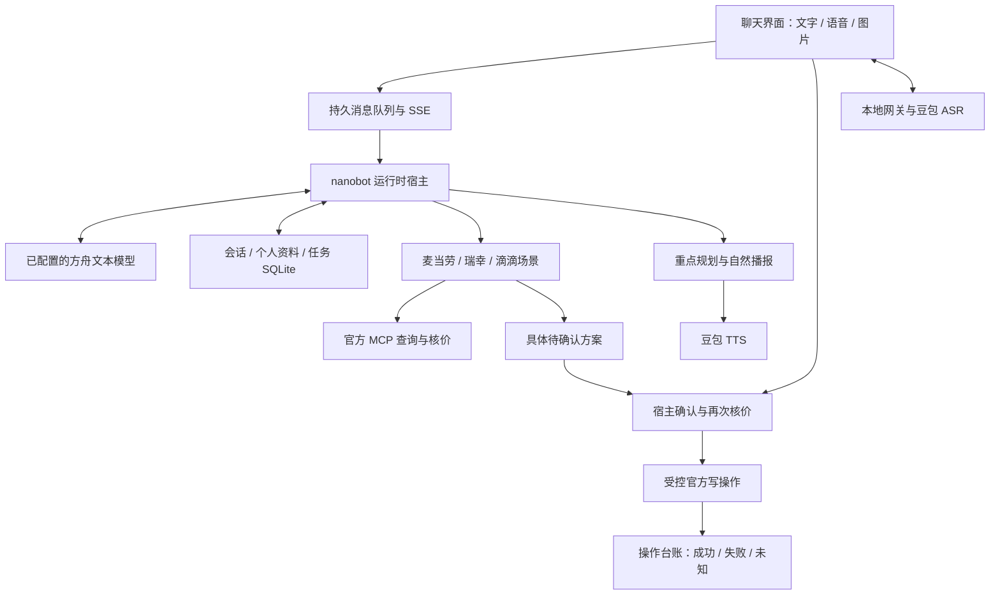

# 技术架构

单机 Mac、单用户、单进程 Python 服务，React 构建后由 FastAPI 提供；SQLite 保存本地状态。文本模型通过火山方舟调用已配置模型，语音使用豆包服务，当前不要求 Redis、向量数据库或独立媒体服务器。

## 模块职责

| 模块 | 职责 |
| --- | --- |
| `frontend/src/` | 固定导航、聊天卡片、图片、录音与持续通话、播放和插话 |
| `app/main.py` | 本地 HTTP 边界、浏览器身份、API、生命周期和静态页面 |
| `app/contact.py`、`contact_events.py` | SQLite 收件箱、客户端 ID 去重、分段合并、串行执行、SSE 增量与重连 |
| `app/agent.py`、`nanobot_runtime.py` | 固定版本 nanobot 0.4.0、上下文、受控工具、事件和会话桥接 |
| `app/foundation_store.py` | 稳定个人资料、召回代际、展示／候选与任务执行记录 |
| `app/skills.py`、`service_skills.py` | 显式注册工具与 Skill，禁止未授权能力旁路 |
| `app/{mcd,luckin,didi}_scenario.py` | 真实候选、参数校验、核价、具体方案和本人状态查询 |
| `app/actions.py`、`plans.py` | 单一确认网关与旧接口兼容视图；旧数据幂等迁移，不保留第二套执行状态机 |
| `app/mcd.py`、`life_services.py` | 官方 MCP 连接、工具发现、实际 schema 校验和业务结果检查 |
| `app/speech.py`、`voice.py`、`voice_protocol.py` | 口语内容规划、合成、实时识别网关与协议边界 |
| `app/attachments.py` | 图片解码、缩放、重新编码与浏览器会话隔离 |
| `app/foundation_scheduler.py` | Cron 生命周期，当前无用户调度与通知投递 |

## 执行与恢复边界

模型只能查询和准备方案。页面确认或准确口头确认由宿主处理，绑定用户、具体方案、版本、有效期与一次性授权；新条件使旧确认失效，排队口令不能批准后来生成的另一份方案。默认交易开关关闭，开关不能代替每笔确认。

宿主先原子认领核价状态，再重新核价和检查实质参数；写入状态持久化后只调用写接口一次。金额、规格、取餐方式或接送点变化后重新确认；预算上限不能靠重新确认绕过。写请求发出后无法确认的结果保存为 `unknown`，重启、超时和重复点击都不自动重放。取消与退款需依据平台实际规则。

消息接收与任务执行分开：收到补充后抑制旧回复的后续展示，再按顺序处理；不强行撤销已经提交的外部写操作。重启将未完成消息标为中断，保留真实结果供核查。

## 会话、资料与权限

网页保留一个持续对话，取消新聊天入口，旧 reset HTTP 接口返回 410；浏览器会话隔离仍保留，刷新和重启恢复原记录。模型会话与网页展示分别持久保存，明确忘记普通资料时仍隔离旧召回，不是物理擦除全部审计文件。任务台账目前主要是执行回执，不能当成完整长期目标管理。

`app/profile_card.py` 定义重要资料字段与格式，`FoundationStore` 将人工确认值和确认时间持久化，`/api/profile/card` 通过显式确认与版本校验更新。模型上下文和资料工具过滤未核对的重要旧记录，模型工具不能改写重要字段；普通偏好与人工核对资料区分。保存后保留当前聊天，失效尚未执行的交易方案，不影响已创建订单。电话号码格式有效不等于号码归属已验证，地址仍需本人核对。

运行时用调用方拥有的工具注册表，并关闭默认文件、shell、web、插件工具及命令旁路。`AgentLoop` 初始化仍可能发现默认工具，因此构造后断言白名单；清空默认命令路由。Hook 可能捕获异常，不能单独承担交易授权。

凭据只在本机后端 `.env`，不返回浏览器或写入公开日志。默认绑定 `127.0.0.1`，HTTP 与 WebSocket 分别检查 Host／Origin，浏览器身份使用 HttpOnly／SameSite cookie。图片按 owner 校验、限制大小和像素、重新编码；音频在请求内存中处理，主动选择发送的内容会交给对应云端服务。

## 语音实现

ASR 输入为 16 kHz 单声道 PCM16，按 200 ms 分包；服务端等待结束指令并返回最终文本，partial 只作字幕。单条录音有 60 秒上限，持续通话按轮次自动接续。网页语音活动检测与停顿策略控制接话，浏览器启用回声消除；效果仍需真人验证。

`text` 保留完整正文，`speech_text` 独立规划。普通复杂回复先筛选重点，再由无工具模型组织口语；预算、改口和明确要求念选项会改变表达。金额／地点／确认与交易状态由宿主事实组合，跳过自由改写。无效或超时使用简短备用表达，不重试业务。较短普通回复直接使用，复杂改写本轮单次约增加 3–4 秒。

TTS 将官方 MP3 音频块直接转发给原生音频播放器，整段播报一个合成请求，可边接收边播放。POST 准备会话绑定、45 秒有效的一次性票据，GET 消耗票据后输出音频流，正文不进入 URL；旧 POST 完整音频接口保留兼容。停止时移除音频源，断开下载并清理上游。短口语的段落换行不会触发二次改写；复杂回答继续独立生成播报。这仍是 ASR → 文本 Agent → TTS 链路，尚非端到端实时语音模型。准备播报不等于用户完整听到，当前没有播放完成回执。

普通非敏感偏好现由 `app/companion_memory.py` 自动整理，使用原话证据、owner／遗忘代际过滤和 BM25 加相邻消息召回；重要资料仍由本人确认。原话保留365天，临时要求不归档，整理失败降级为原话检索。推断记忆现支持直接肯定请求下的词法主题删除，并轮换模型上下文；显式普通资料删除后保留当前用户的其他推断主题。尚无完整语义主题删除、删除墓碑与可恢复的后台整理队列；主动触发和内容服务仍属规划。实现审计、公开数据结果和限制见[记忆评测报告](docs/research/personal-agent-2026-11-06/assessment.md)。

## 审查后的职责边界

`create_app(services=..., services_factory=...)` 在每个应用实例上注入依赖。模块导入只建立路由和惰性引用，不创建数据库或启动调度器；lifespan 负责恢复、启动和关闭。请求上下文隔离不同应用的依赖。旧的命名导入保留为惰性代理，便于兼容已有集成。

前端 `main.tsx` 只挂载应用，`useAppController` 协调副作用。`useChat` 用 reducer 管理消息，`useContact` 负责恢复与 SSE，`usePhone` 管理通话，`useComposer` 管理输入和图片，`useLocation` 管理定位；被动视图在 `components/`。SSE 数据先按 `ContactEvent` 联合类型对应的运行时规则校验，再进入穷举 switch。历史 `plan` 卡片只适配为统一 `ActionCard`，前端不再执行 `/api/plans/*` 交易流程。

模型输入由 `model_views.py` 的逐层、分服务白名单投影。未知字段及容器默认丢弃，已允许的标量字段也不能容纳任意对象。模型不能看到确认令牌、内部请求或报价载荷。语言策略保存在 `app/policies/`，能力目录和执行开关是运行时事实。预算、选择、确认、单次执行和未知状态等约束继续由适配器与网关强制实施。

业务回复经 `factual_replies.py` 从工具事实或操作状态生成；未核实的模型交易措辞不流式发给用户。交易和服务选项的语音直接使用宿主事实，只有普通对话可进行无工具口语改写。`valid()` 是补充内容检查，不承担交易正确性证明。

所有方案的新公开结构使用 `summary_version=1` 与英文 snake_case 字段，中文标签属于展示层。`normalize_summary` 读取旧键但不重写历史审计文件。金额仍为整数分，前后端统一精确格式化。

`PlanStore` 是兼容外观：旧表逐条幂等导入 `actions`，保留 owner、id、未知状态和原记录，并保存到统一网关的绑定。迁移不请求远端、不执行旧授权；提交中断仍进入 unknown，重核价中断进入 expired。`/api/plans` 兼容端点也调用相同 CAS、重核价和执行入口，旧工具不再向模型注册。公开接口保留以免历史客户端失效，可在确认所有调用方完成迁移后再移除。

MCP 的结构解码在 `mcp_payload.py` 复用；各 provider 仍分别验证自己的成功封装、拒绝结果和授权工具目录。`has_pending_any` 与 `has_pending_call` 分别表示所有队列和指定通话队列，SQL 的 `IS` 明确保留 NULL 安全比较语义。

本轮能力矩阵、LongMemEval／LoCoMo 前后评测与缺口见[能力检查报告](docs/evaluations/personal-agent-2026-11-06/audit.md)。

## 飞猪机票查询与外部预订

`app/fliggy.py` 以严格参数模型注册 `fliggy_search_flights`，通过固定官方签名 CLI 查询航班；不注册机票写操作，也不进入 `ActionManager` 交易执行流程。模型只接触显式投影的航段、票价、查询时间和官方预订链接。`flight_result` 事件随对话持久化，前端在文字、通话及历史恢复时渲染 `FlightResults` 卡片；用户点击官方 HTTPS 入口后在飞猪核对并付款，宿主不自动打开、不代付，也不能推断跳转后的出票状态。

家人设置通过 `/api/settings` 以只写方式保存 `FLYAI_API_KEY`，不回显已保存的密钥。`/api/settings/prepare/fliggy` 下载固定版本官方组件并验证 SHA-512；`/api/settings/test/fliggy` 使用七天后北京至上海的固定公开查询，返回状态而不返回航班原始载荷或凭据。只读预览禁止配置变更、组件准备及配置检查；已准备好的航班查询仍在只读工具白名单内。`/api/health` 分别报告凭据存在、组件存在和只查询边界；它们不代表真实查询或出票已经通过。
