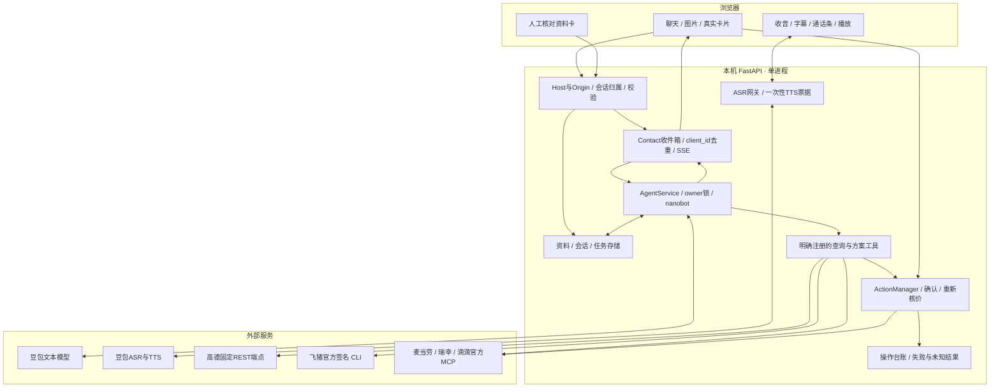
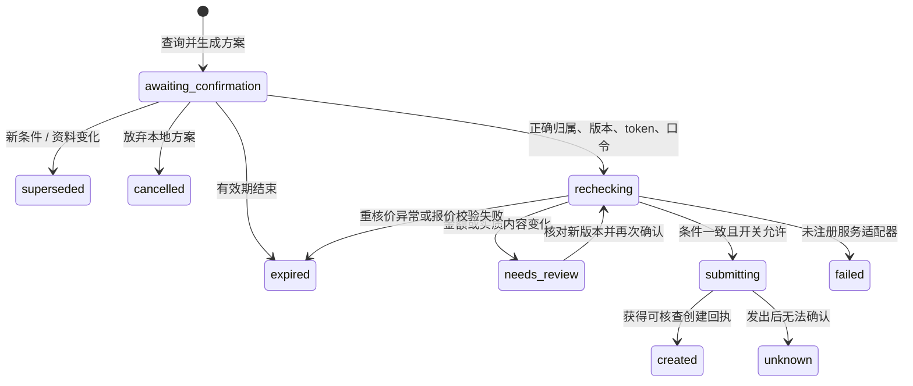
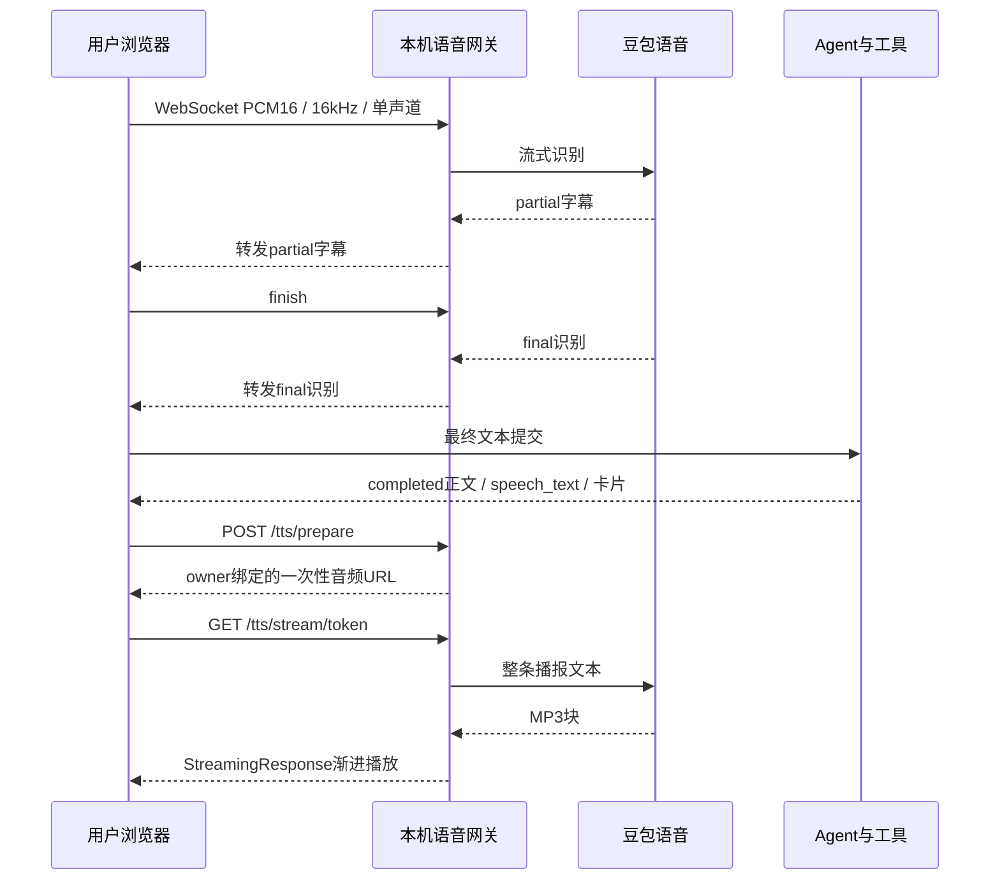

# 系统架构：模型负责提案，宿主负责状态与执行

> 部署见[部署与配置](docs/setup.md)，资料与召回见[个人资料与记忆](docs/memory.md)。

## 1. 运行单元与设计选择

当前部署单元是 **Mac 上单用户、单进程 FastAPI 服务＋同源 React 网页**。开发与离线测试可在 Linux 运行，Mac 启动器和真人手机体验要分别验收。前端构建随仓库提供；运行状态存 SQLite 和本机文件。模型、ASR／TTS、地图及生活服务通过云端接口协作。

| 选择 | 解决什么问题 | 代价／边界 |
|---|---|---|
| 同源网页与API | 无需独立前端服务器，统一cookie、SSE和语音网关 | 当前仅信任回环来源，不能直接分享为手机访问链接 |
| SQLite与本机工作区 | 单机可检查、可备份，重启保留资料和回执 | 没有多用户授权、同步与加密存储；备份须一致快照 |
| 固定 nanobot 0.4.0 | 复用模型／工具循环与持久对话 | 必须锁依赖；不能将依赖自带所有工具开放给模型 |
| 宿主工具注册表 | 能力入口可枚举，查询与外部写入分离 | 新服务需实现适配、状态和确认，不是粘贴MCP URL即生效 |
| Agent与收件箱解耦 | 用户能补充、界面能显示真实进度 | 仍按owner串行处理；并非可独立恢复的长期目标调度器 |
| ASR→Agent→TTS | 接入现有文本工具和事实校验 | 文字和播报可分次交付；正式电话仍走 ASR、Agent、TTS |



## 2. 一条需求如何变成可核查结果

1. 网页提交 `text`、`client_id` 和可选图片／`call_id`。`ContactService`先校验归属、去重和队列上限，将消息持久化后返回接收回执。
2. 每个owner的worker短暂收集连续片段（当前350ms设计值），区分电话／文字通道和确认消息，然后串行调用Agent。
3. `AgentService`恢复当前会话并注入权威资料、实际服务候选、近期操作与当前能力策略。nanobot调用注册工具，宿主校验参数、查询官方服务并发布真实工具进度。
4. 普通回复可先交付文字，独立播报完成后发送 `speech_ready`；业务结果由宿主根据真实工具数据和交易状态组织正文与播报。查询结果附真实候选卡片。变化后的旧回复被标为superseded，不继续自动展示／播报。
5. 涉及外部写入时只形成具体方案。当前卡片或准确口头确认进入宿主网关，不由模型直接执行交易。
6. 收件箱与执行回执分别落盘；网页用SSE接收，重连按cursor恢复。未完成消息在重启时标为中断，不自动重新发单。

**四种ID不可互换：**`client_id`用于消息接收去重；`message_id`关联处理与进度；`call_id`标识浏览器通话；action／plan ID与版本绑定具体待确认操作。它们都不是一个完整长期目标的统一ID。

## 3. 确认状态机保证不盲目重试，不能保证外部恰好执行一次



图示突出创建路径。取消请求还有`cancellation_requested`／`cancelled`等结果，配送地址创建有`address_created`；全部状态以[actions.py](app/actions.py)为准。旧麦当劳自取还有兼容的[plans.py](app/plans.py)台账。

宿主校验owner、方案版本、有效期、确认token和准确口令；原子认领后重新核价，比较实质参数和预算，再持久化提交状态。新条件使旧确认失效；变价需要重新核对，超预算不能靠确认绕过。

`submitting`后的超时、取消或异常保存为`unknown`。外部服务不一定提供端到端幂等，因此只能承诺**宿主不盲目重放未知写入**，不能宣称网络异常下外部恰好执行一次。先查询实际订单，再决定处理方式。关闭播报或挂断不等于取消后台工作，取消本地方案不等于取消真实订单。

`MCD_ORDER_ENABLED`、`LUCKIN_ORDER_ENABLED`、`DIDI_ORDER_ENABLED`默认false。新增配送地址独立确认且不受订单开关约束；`XIAORUI_READ_ONLY=1`才会拒绝当前写操作和配置修改。模型没有付款工具。

## 4. 资料、会话、任务与交易是不同的持久状态

默认根目录为`.local-data/`，不进入Git：

| 存储 | 内容 | 恢复与限制 |
|---|---|---|
| `personal-agent/foundation.sqlite3` | `facts`、人工确认资料、profile版本／forget_epoch、owner会话快照、任务回执 | 资料跨浏览器共享；会话／任务按owner区分；不是多租户数据库 |
| `personal-agent/runtime/sessions/<workspace-id>/sessions.sqlite3` | nanobot持久对话及其运行时会话状态 | 由锁定依赖管理；上下文有预算，非任意历史检索 |
| `personal-agent/runtime/workspace/` | 宿主管理的身份、策略与复制的skills | 当前禁止默认文件工具，dream关闭；不据目录存在声称自动记忆提炼 |
| `personal-agent/companion.sqlite3` | 带角色的原话片段、偏好及证据、召回屏障 | 按 owner 与代际召回，受上下文预算限制 |
| `personal-agent/contact.sqlite3` | 收件箱、SSE事件、通话起止与时长 | 电话转录可能留在底层记录；关闭页面不是删除 |
| `personal-agent/actions.sqlite3` | 三平台方案、确认和执行结果 | 所有权／版本保护；未知不重放 |
| `plans.sqlite3` | 旧麦当劳自取方案 | 经兼容层迁入统一台账，保留历史归属与未知状态 |
| `personal-agent/images/` | 已发送图片及本机元数据 | owner检查、格式／大小约束；可能发送云端模型 |

短期浏览器定位在内存中按owner保存，有效期120秒；不自动写成家。TTS一次性票据在内存中，45秒失效，重启不恢复。昵称头像为当前浏览器localStorage外观设置，不是正式身份或权威个人资料。

事实每轮以`canonical_profile`注入。普通偏好可显式更新，也可从用户原话整理并保存证据；重要地址／电话只能人工确认。忘记更新删除标记与召回代际，轮换后续会话；旧SDK记录、消息事件、任务和备份并不自动物理删除。完整语义、测试和可用性判断见[记忆架构](docs/memory.md)。

## 5. 语音分成采集、识别、回复和播放四段



ASR每包200ms音频，partial只展示、final才提交。单条录音有时长限制；持续通话按轮接续。网页音量活动与字幕决定停顿提交，启用浏览器回声消除；参数不是老人通用最佳值。

TTS不再等完整blob才播放；旧完整音频POST接口为兼容保留。停止会中断旧播放和下载，generation用于隔离迟到结果。**边接收音频边播放不等于边生成模型文本边发声**；语音等待可播报文本，普通文字回复可以先发出。当前没有可靠的“用户已完整听到”业务回执。

语音复现见[验证与复现](docs/acceptance.md)。

## 6. 完整开发目录与模块职责

```text
xiaorui/
├── README.md / ARCHITECTURE.md / CHANGELOG.md / CONTRIBUTING.md
├── 启动.command             # Mac前台启动器
├── pyproject.toml / uv.lock # Python3.12与依赖锁
├── .env.example            # 空配置模板，实际.env忽略
├── app/                    # API、Agent、状态、语音和服务
├── frontend/
│   ├── src/                # React/TypeScript组件与交互
│   ├── tests/              # Node行为测试
│   ├── public/mascot/      # 陪伴角色素材
│   └── dist/               # 可直接交付的前端构建
├── skills/                 # 宿主复制的领域说明，权限仍由代码控制
├── tests/                  # Python离线边界与回归测试
├── experiments/            # 人工按范围运行的真实联调探针
├── docs/                   # 部署、记忆、服务与验证
│   ├── acceptance/         # 带版本和范围的验收证据
│   └── research/           # 历史研究快照，不是运行时依赖
└── .local-data/            # 私人运行数据，忽略且不分发
```

| 模块组 | 现存文件与职责 |
|---|---|
| HTTP与生命周期 | `main.py`：路由、cookie、Host／Origin、恢复和静态资源；`settings.py`：掩码读取、字段校验和本机配置 |
| 收件箱与事件 | `contact.py`：去重、合并、worker、通话；`contact_events.py`：本轮上下文；`progress.py`：真实工具进度 |
| Agent | `agent.py`：上下文与任务桥接；`nanobot_runtime.py`：策略、白名单、命令关闭和运行时构造 |
| 记忆与维护 | `foundation_store.py`、`profile_card.py`：资料／会话／回执；`foundation_scheduler.py`：受限维护Cron |
| 能力注册 | `skills.py`、`service_skills.py`、`read_only.py`：schema、宿主路由和只读策略 |
| 领域流程 | `mcd_scenario.py`、`luckin_scenario.py`、`didi_scenario.py`：候选、规格、核价与方案 |
| 记忆召回与业务文本 | `companion_memory.py`：证据检索与屏障；`factual_replies.py`：基于宿主事实组织业务回复 |
| 飞猪机票 | `fliggy.py`、`fliggy_setup.py`：查询、固定版本组件准备与连接检查 |
| 官方连接 | `mcd.py`、`life_services.py`：MCP；`service_transport.py`：代理；`amap.py`：固定REST；`location.py`：定位 |
| 执行与推荐 | `actions.py`、`plans.py`：新旧确认台账；`recommendations.py`：真实菜单推荐 |
| 媒体 | `voice.py`、`voice_protocol.py`、`speech.py`：ASR／TTS／播报；`attachments.py`：图片处理与归属 |
| 网页 | `main.tsx`：消息与SSE；`useVoice.ts`：收音与播放；`CallBar.tsx`：通话条；`ActionCard.tsx`：确认；`ProfileCard.tsx`：资料；`SettingsDialog.tsx`：设置；`Companion.tsx`：角色；`location.ts`：定位；CSS：样式 |

模块与对应测试见[开发地图](docs/development.md)。

### 运行时与模块边界

`create_app(services=..., services_factory=...)` 在每个应用实例上注入依赖。模块导入只建立路由和惰性引用，不创建数据库或启动调度器；lifespan 负责恢复、启动和关闭。请求上下文隔离不同应用的依赖。旧的命名导入保留为惰性代理，便于兼容已有集成。

前端 `main.tsx` 只挂载应用，`useAppController` 协调副作用。`useChat` 用 reducer 管理消息，`useContact` 负责恢复与 SSE，`usePhone` 管理通话，`useComposer` 管理输入和图片，`useLocation` 管理定位；被动视图在 `components/`。SSE 数据先按 `ContactEvent` 联合类型对应的运行时规则校验，再进入穷举 switch。历史 `plan` 卡片只适配为统一 `ActionCard`，前端不再执行 `/api/plans/*` 交易流程。

模型输入由 `model_views.py` 的逐层、分服务白名单投影。未知字段及容器默认丢弃，已允许的标量字段也不能容纳任意对象。模型不能看到确认令牌、内部请求或报价载荷。语言策略保存在 `app/policies/`，能力目录和执行开关是运行时事实。预算、选择、确认、单次执行和未知状态等约束继续由适配器与网关强制实施。

业务回复经 `factual_replies.py` 从工具事实或操作状态生成；未核实的模型交易措辞不流式发给用户。交易和服务选项的语音直接使用宿主事实，只有普通对话可进行无工具口语改写。`valid()` 是补充内容检查，不承担交易正确性证明。

所有方案的新公开结构使用 `summary_version=1` 与英文 snake_case 字段，中文标签属于展示层。`normalize_summary` 读取旧键但不重写历史审计文件。金额仍为整数分，前后端统一精确格式化。

`PlanStore` 是兼容外观：旧表逐条幂等导入 `actions`，保留 owner、id、未知状态和原记录，并保存到统一网关的绑定。迁移不请求远端、不执行旧授权；提交中断仍进入 unknown，重核价中断进入 expired。`/api/plans` 兼容端点也调用相同 CAS、重核价和执行入口，旧工具不再向模型注册。公开接口保留以免历史客户端失效，可在确认所有调用方完成迁移后再移除。

MCP 的结构解码在 `mcp_payload.py` 复用；各 provider 仍分别验证自己的成功封装、拒绝结果和授权工具目录。`has_pending_any` 与 `has_pending_call` 分别表示所有队列和指定通话队列，SQL 的 `IS` 明确保留 NULL 安全比较语义。


### 飞猪机票查询与外部预订

`app/fliggy.py` 以严格参数模型注册 `fliggy_search_flights`，通过固定官方签名 CLI 查询航班；不注册机票写操作，也不进入 `ActionManager` 交易执行流程。模型只接触显式投影的航段、票价、查询时间和官方预订链接。`flight_result` 事件随对话持久化，前端在文字、通话及历史恢复时渲染 `FlightResults` 卡片；用户点击官方 HTTPS 入口后在飞猪核对并付款，宿主不自动打开、不代付，也不能推断跳转后的出票状态。

家人设置通过 `/api/settings` 以只写方式保存 `FLYAI_API_KEY`，不回显已保存的密钥。`/api/settings/prepare/fliggy` 下载固定版本官方组件并验证 SHA-512；`/api/settings/test/fliggy` 使用七天后北京至上海的固定公开查询，返回状态而不返回航班原始载荷或凭据。只读预览禁止配置变更、组件准备及配置检查；已准备好的航班查询仍在只读工具白名单内。`/api/health` 分别报告凭据存在、组件存在和只查询边界；它们不代表真实查询或出票已经通过。

## 7. API按使用边界分组

以下为现有入口地图，不是稳定的公共SDK；请求模型和返回字段以源码为准。

| 类别 | 路径 | 作用 |
|---|---|---|
| 状态 | `GET /api/health`、`/api/foundation` | 配置标记、基础组件与能力信息，不返回密钥 |
| 消息 | `POST /api/contact/messages`、`GET /api/contact/state`、`/api/contact/events` | 接收、恢复与SSE |
| 通话 | `POST /api/contact/calls`、`/api/contact/calls/{id}/end` | 开始／结束浏览器通话记录 |
| 资料 | `GET /api/profile`、`GET/PUT /api/profile/card` | 资料读取与显式版本确认 |
| 媒体 | `/api/contact/images`、`/api/voice/asr`、`/api/voice/tts/prepare`、`/api/voice/tts/stream/{token}` | 图片、ASR WebSocket、渐进播报 |
| 定位 | `POST/DELETE /api/location` | 短期位置与旧方案失效 |
| 方案 | `/api/actions`、`/{id}/confirm`、`/{id}/refresh`、`/{id}/prepare-cancel`、`/{id}/cancel-plan` | 核查、执行、查询与本地放弃 |
| 兼容 | `/api/chat`、`/api/chat/history`、`/api/mcd/*`、`/api/plans/*` | 同步聊天与旧方案兼容路由；旧方案走统一网关，reset 返回 410 |
| 配置 | `/api/settings`及其检查入口 | 本机家人配置；没有独立管理员认证 |

## 8. 访问、隐私与验证

HTTP与WebSocket分别检查回环Host和精确Origin；JSON写请求、参数schema、工具白名单与owner检查构成当前本地边界。`pa_session`是归属cookie，不是登录。所有资料共享一个`local-user`，没有家庭角色、任意远程用户授权或公网安全交付。

日志与备份可能含个人内容。停止服务后备份数据库和所需私有文件，勿提交`.env`、`.local-data/`、真实订单、配对资料或支付链接。无数据库加密或全面删除API的保证。外部服务的数据处理规则独立适用。

验证命令与已记录的服务样本见[验证与复现](docs/acceptance.md)。
