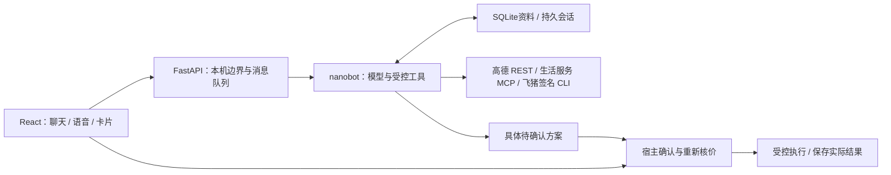

<div align="center">
  
  <h1>小瑞 · Xiaorui</h1>
  <p><strong>家人提前配好，老人开口就能用。</strong></p>
  <p>A local-first personal assistant for everyday life.</p>
  <p>文字与语音 · 可核查的记忆 · 真实生活服务 · 由人确认的执行</p>
  <p><a href="#快速开始">快速开始</a> · <a href="ARCHITECTURE.md">技术架构</a> · <a href="docs/memory.md">长期记忆</a> · <a href="CHANGELOG.md">更新记录</a> · <a href="CONTRIBUTING.md">参与开发</a></p>
</div>

小瑞是一个运行在 Mac 本地的中文个人生活助手。它用熟悉的聊天、语音和卡片，帮助老人查路线、选餐品、核对费用、安排出行；用人工核对的资料和显式保存的偏好延续上下文，把真实业务交给官方服务完成。

**当前是可运行的工程原型，处于真实服务整合与适老体验验收阶段。** 已实现持久记忆和受控业务执行；尚未证明老人能独立完成完整的语音生活服务链路。本地保存状态，文本、语音及生活服务仍需要云端 API。


上图来自隔离聊天验收，界面会随版本更新。

## 为什么做小瑞

- **先理解，再逐步引导。** 老人可以分几句话补充需求，处理中仍能说话或打字；需要选择时展示实际门店、商品和方案。
- **记住经过确认的内容。** 家庭地址和联系人通过资料卡核对；普通偏好可以明确记住、修改和忘记。旧聊天不能覆盖当前已确认资料。
- **查询与执行分开。** 模型可以查询、推荐和准备方案；花钱、取消订单和新增配送地址由宿主核对明确确认后执行。
- **让过程可以检查。** 消息、工具进度、任务回执与交易状态分别记录；超时或结果未知时先核查，不盲目重放。

## 今天能用到哪里

| 能力 | 当前实现 | 仍需验证／尚未提供 |
|---|---|---|
| 聊天与图片 | 持续对话、图片消息、送达反馈、逐消息进度、刷新恢复 | 多用户公网服务、跨设备身份管理 |
| 语音 | 流式识别与字幕、独立通话、插话停播、渐进 MP3 播放、通话中打字 | 真人老人、方言、回声与弱网；并非 GPT Live 式端到端全双工 |
| 记忆 | 人工确认资料卡、偏好整理、带原话证据的历史召回、主题遗忘 | 成熟语义检索、可靠的跨会话推理和候选记忆审批 |
| 地图与天气 | 高德地点搜索、地址解析、步行／驾车路线、实时天气 | 持续跟随导航、后台位置追踪 |
| 用餐与出行 | 麦当劳、瑞幸、滴滴查询、候选、核价、具体确认方案及部分受控写操作 | 通用外卖／购物、全程自动付款、完整配送与退款闭环 |
| 机票 | 飞猪实时搜索、航班卡片、官方预订入口 | 乘机人核对、含税总价、支付和出票由飞猪处理 |
| 任务与提醒 | 处理回执、交易台账、中断与未知状态；基础 Cron 生命周期 | 可恢复的长期目标管理、到时主动提醒或联系家人 |

当前网页提供一个持续对话。电话里的口头交流不逐句刷入聊天，挂断后保留时长，需要操作的卡片仍进入聊天区；**底层处理记录可能保留转录文本**。这里的通话是浏览器语音交互，不是微信或运营商电话。

### 接入的是实际服务，不是模拟菜单

| 服务 | 接口与当前范围 | 关键边界 |
|---|---|---|
| **高德地图** | 官方 REST：地点、地理编码、路线、天气 | 路线是查询时的快照；Key 为 Web服务类型 |
| **麦当劳** | 官方 MCP：门店／菜单、规格、同店购物车、配送地址、核价、订单及取消条件 | 餐饮点餐仅支持麦当劳；新增地址也是外部写入，需要独立确认 |
| **瑞幸** | 官方 MCP：坐标查店、饮品规格、核价、本人订单 | 外送与完整交易未验收；未知请求保护不自动解除 |
| **滴滴** | 官方 MCP：地点、接送点、车型估价、确认叫车、本人订单、司机位置、取消条件 | 估价不是最终车费；关联账号可能免密扣款，取消费用未知时转官方渠道 |
| **飞猪** | 官方签名 CLI：按日期、城市和条件查询航班 | 预订链接进入飞猪核对；搜索报价会变动 |

地点不明确时核对城市与候选，不猜当前位置。麦当劳已有北京自取、广州外送报价证据；瑞幸和滴滴主要围绕北京实现。高德搜到一家餐厅，只代表找到地点，**不代表能替它下单**。尚未接入美团、饿了么、淘宝、挂号或任意手机 App 自动化。详见[服务边界](docs/services.md)。

## 快速开始

### 方式一：Mac 启动器

克隆或下载仓库，双击根目录 [`启动.command`](启动.command)。先安装 uv（例如 `brew install uv`）。首次联网准备 Python 3.12 和锁定依赖；仅在缺失时创建 `.env`，随后打开 **[http://127.0.0.1:8000](http://127.0.0.1:8000)**。按 `Control+C` 或关闭前台启动窗口停止服务。

仓库附有前端构建，普通聊天可直接使用；飞猪组件另需 Node.js 18 或以上版本。模型及服务凭据仍需本人或家人在本机填写，空配置会如实报错。**干净 Mac 的一键启动仍待独立验收。**

### 方式二：开发启动

准备 Python **3.12**、[uv](https://docs.astral.sh/uv/) 和 Node.js/npm。在尚不存在的目录克隆：

```sh
git clone https://github.com/perry112926-ai/xiaorui.git
cd xiaorui

# 保留已有配置，创建新文件时使用私有权限
umask 077
[ -e .env ] || cp .env.example .env
chmod 600 .env

uv sync --locked --python 3.12
npm --prefix frontend ci
npm --prefix frontend run build
uv run --no-sync uvicorn app.main:app --host 127.0.0.1 --port 8000
```

启动前在本机编辑 `.env`，或打开页面后点击顶部头像进入家人设置。不要将 Key 发到聊天或写入前端。默认 **单用户、单进程、仅回环访问**；`127.0.0.1` 不能直接分享给另一部手机。安装、配置、常见错误、备份与停止方法见[部署指南](docs/setup.md)。

### 最小配置

| 你要使用什么 | 填写什么 |
|---|---|
| 文字聊天与 Agent | `ARK_API_KEY`、`ARK_MODEL`；默认官方 `ARK_BASE_URL` |
| 语音输入与播报 | `DOUBAO_SPEECH_API_KEY`；识别与合成需分别开通，文本 Key 不通用 |
| 地图与天气 | `AMAP_KEY`，在高德控制台创建 **Web服务** Key |
| 麦当劳／瑞幸／滴滴 | 对应 `MCD_MCP_TOKEN`／`LUCKIN_MCP_TOKEN`／`DIDI_MCP_KEY` |
| 飞猪机票 | `FLYAI_API_KEY`，在家人设置准备组件并检查连接 |

完整配置以 [`.env.example`](.env.example) 为准；资源 ID、模型额度、代理策略和服务获取入口见[配置指南](docs/setup.md)。家人设置支持豆包、麦当劳、瑞幸、滴滴和飞猪；高德通过 `.env` 配置。**Key 已保存不代表权限或远端连接已验证。**

### 第一次使用

1. 先配置文本模型，用“陪我聊聊天”验证真实回复。
2. 在“我的资料卡”核对家庭地址和联系人；试着说“请记住，我更喜欢热饮”，刷新后询问，再明确要求忘记。
3. 配置一个服务，先做只读查询：“北京现在天气怎么样？”或“查一下麦当劳菜单”。
4. 再测试语音权限、两轮对话、插话、停止与错误恢复；最后才评估具体交易。

可用以下模式演示已允许的麦当劳、高德与飞猪查询：

```sh
XIAORUI_READ_ONLY=1 uv run --no-sync uvicorn app.main:app --host 127.0.0.1 --port 8000
```

只读模式还会禁止配置修改、记忆写入、地址新增和交易准备／执行。移除此环境变量并重启才能恢复普通模式。

## 长期记忆确实实现了，但有明确范围

重要地址和电话通过资料卡人工确认。普通偏好可以明确增改，也能从有原话证据的对话中整理。后续对话在预算内召回相关片段；明确忘记会更新召回边界，隔离旧会话与旧任务，日志和备份仍有各自的保留范围。任务与交易台账保存实际结果。

实现、评估及已知限制见[记忆架构](docs/memory.md)。

## 系统如何协作



Python 3.12 · FastAPI · nanobot 0.4.0 · SQLite · React · TypeScript · Vite。语音走豆包 ASR → 文本 Agent → TTS；没有要求 Redis、向量库或独立媒体服务器。完整模块、目录、API 和恢复设计见 **[ARCHITECTURE.md](ARCHITECTURE.md)**。

## 交易与数据边界

三个 `*_ORDER_ENABLED` 开关默认 `false`。开启某个平台只允许进入其受控执行路径，不能替代每笔明确确认。

**真实查询 → 具体方案 → 人工核对 → 明确确认 → 再次核价 → 宿主执行 → 核查结果。** 改需求使旧方案失效；结果未知先核查，不自动重试外部写入。创建订单不等于支付成功，放弃本地方案不等于取消真实订单。新增配送地址独立确认，**不受订单开关关闭的保护，应使用强制只读模式禁止外部写操作及资料／配置修改**。

`.env` 和 `.local-data/` 不进入 Git。资料、会话、任务、订单和图片会保存在本机；完成任务所需的文本、音频、图片或业务字段会发送给相应云服务。本地部署不是离线运行。当前 cookie 用于会话归属，**不是登录认证或家人管理员权限**；不要直接绑定公网、开放通配跨域或将设置页暴露给局域网。见[数据与运行边界](docs/setup.md#数据备份与访问边界)。

## 验证状态

| 证据类型 | 当前依据 | 不能据此推导 |
|---|---|---|
| 离线程序验证 | 飞猪家人设置验收记录：后端 **372** 项、前端 **94** 项测试及生产构建通过 | 用户 Mac、真人语音、老人使用或真实交易已全面通过 |
| 真实只读接口 | 仓库保留高德四类查询、真实模型天气对话、三平台查询与核价记录，以及飞猪真实航班查询、浏览器卡片与刷新恢复 | 所有地区、账号、时段均可用 |
| 分项交易实验 | 公开记录有麦当劳待支付订单／官方支付入口；上游维护说明另记录滴滴发单和司机接单，未附可供本轮独立复验的公开回执 | 全程支付、配送到家、稳定取消退款或可无人值守运行 |
| 记忆评估 | 九轮虚构对话验证重启召回与主题遗忘；LongMemEval-S 500 题为 76.8%，基线 76.0% | 稳定提升、成熟跨会话推理或完整产品通过 |
| 语音专项 | 渐进播放已接入；Pipecat 十轮合成语音与 WebRTC 为独立验证 | 正式电话入口已迁移、真人麦克风到浏览器出声的时延 |
| 真人与交付 | 尚待目标用户、方言／回声／弱网、完整生活服务及干净设备验收 | 已达生产可用或 GPT Live 听感 |

测试命令与证据索引见[验收说明](docs/acceptance.md)。真实接口实验可能产生费用；真实交易必须事先核对具体方案，不能为了演示擅自发单。

## 文档与参与开发

| 入口 | 读完能解决什么 |
|---|---|
| [文档导航](docs/README.md) | 按使用者、开发者、审查者找到入口 |
| [部署与配置](docs/setup.md) | 在本机启动、配服务、排错、备份 |
| [架构设计](ARCHITECTURE.md) | 理解数据流、模块、存储、API与执行边界 |
| [长期记忆](docs/memory.md) | 判断哪些记忆真实实现，如何验证 |
| [开发地图](docs/development.md) | 修改一个功能时该读哪些文件、跑哪些测试 |
| [更新记录](CHANGELOG.md) | 按真实提交追溯每轮重要演进与分支差异 |
| [贡献指南](CONTRIBUTING.md) | 提交可复现问题、验证改动、准备PR |
| [服务边界](docs/services.md) · [高德](docs/amap.md) · [飞猪](docs/fliggy.md) · [电话](docs/phone-interaction.md) | 核对接口范围与已有证据 |
| [产品理念](docs/product-identity.md) · [路线图](docs/roadmap.md) | 区分已实现能力与下一阶段 |

欢迎提交可复现的问题、适老交互反馈、测试与小范围改进。当前优先补齐真人语音、历史召回边界和干净环境交付，不以增加工具数量代替完整体验。

**项目许可待维护者明确选择。** 当前根目录未提供项目级 `LICENSE`，不能据此认定允许自由再分发或闭源商用；依赖与研究快照遵循各自许可。详见[贡献与许可说明](CONTRIBUTING.md)。项目与高德、麦当劳、瑞幸、滴滴等平台无官方隶属关系。

<details>
<summary>项目起点：原始任务</summary>

> 实现一套可本地部署的 Personal Agent 服务。语言、模型、调度框架、Skill 全部自选；核心要求是尽可能对接真实外部 API（如高德、麦当劳等），而非 mock 接口，最终交付可一键本地跑起来的版本，附带设计说明，以 GitHub 链接的形式给出

原文保留在 [docs/original-task.md](docs/original-task.md)。后续适老陪伴愿景不冒充原题评分要求。

</details>
