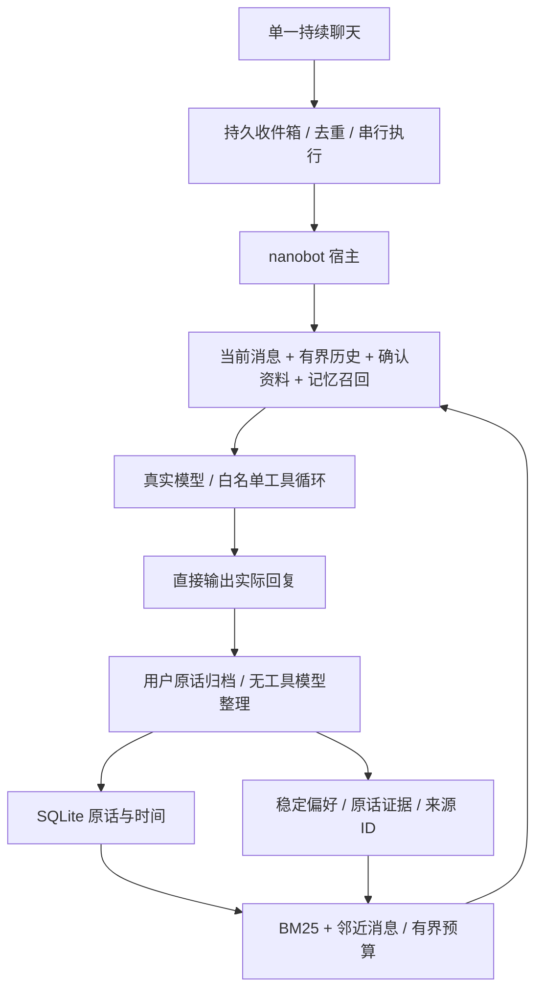

# Personal agent 实现审计与记忆评测（2026-11-06）

## 结论与验收边界

项目不是纯聊天框：nanobot 真实运行模型工具循环，宿主拥有持久收件箱、会话、资料及受控操作台账。但这不等于成熟的全能力 personal agent。原先稳定偏好主要靠显式 personal_profile 工具，Dream 关闭；没有自动整理与带来源召回的完整产品链路。单一聊天入口不等于无限上下文，也不等于长期记忆。

本轮实现自动偏好整理、独立原话检索和遗忘代际隔离，取消每条消息的固定回执。公开 LoCoMo 测试暴露出多跳和开放推断弱项；不能宣称已经达到开源 benchmark 的领先或高分水平。下面的检索分数和20题诊断不是完整官方 QA 复现，也不能证明完整 personal agent 能力达标。

## 外部材料与可借鉴内容

- [Muse 官方产品介绍](https://ai.meta.com/muse/)描述面向个人的持续执行与行动能力；公开产品描述不能证明其内部记忆算法。另一个 [Muse 设计页面](https://introducing.muse.ai/)重定向后无法读取，不把搜索摘要当架构证据，也不混淆同名产品。
- [Letta stateful agents](https://docs.letta.com/v1-sdk/concepts/stateful-agents)：持久状态、上下文层次、记忆块与归档是独立能力。借鉴“工作上下文有界，长期状态独立”的原则，不因为采用某框架就认定已实现所有能力。
- [nanobot 固定依赖源码](https://github.com/HKUDS/nanobot)：本地0.4.0包含 transcript archiving、summary checkpoint 和 Dream。检查实际安装代码可确认前两者参与上下文压缩；Dream 被宿主明确禁用。宿主 LatencyProvider 又替换 system prompt，所以不能只看到 SDK 的 MEMORY.md 就断言模型会读取它。
- [LongMemEval 官方仓库](https://github.com/xiaowu0162/LongMemEval)：测试跨会话提取、时间推理、更新等长期记忆能力；oracle 只提供证据会话，不能冒充完整检索成绩。本轮未运行 LongMemEval。
- [LoCoMo 官方仓库](https://github.com/snap-research/locomo)：公开十段长对话及问题、答案、证据标注。本轮使用真实 locomo10.json，不使用自编问题冒充公开基准。

没有可核验资料证明“豆包工作伙伴”的内部记忆实现，本轮不据产品体验反推其架构。

## 本轮实际链路



- `app/text_delivery.py`：保留传输层 accepted 语义，acknowledgement 返回空串，不再插入“收到，我看看”聊天气泡。运行时提示也要求直接回复内容。
- `app/companion_memory.py`：owner + forget_epoch 双重过滤，SQLite 重启持久；每次成功对话后自动整理最多5条非敏感稳定偏好。同一语义键覆盖旧值，保留原话证据及来源 ID。原话检索最多扫描最近10,000条，默认32条、14,000字符预算；加入前后两条的衰减扩展。data_context 仍受宿主总长度限制。
- 提问不能作为新的偏好证据；今天／临时／不保存的内容不进入该记忆库。重要资料仍由确认资料卡管理。整理输出要求精确原话子串，并过滤敏感字段；这不能保证模型从不误提取。
- 整理失败降级为原话归档，通过 memory.learn trace 暴露状态，不把网络错误包装成保存成功。整理请求最多等待8秒，当前在成功任务结束前执行；可能影响队列吞吐，尚未做独立后台任务恢复。
- 原话保留365天，召回也按期限过滤；整理偏好持续保留到更新／遗忘。遗忘采用保守策略清除当前 owner 的整个推断记忆库；不是细粒度主题删除，也不是对所有审计文件的物理擦除。既有 profile 删除仍切换召回代际。
- 关闭共享 SDK MEMORY.md 注入，避免没有 owner／遗忘代际的另一份记忆旁路；每个 SDK session 的历史压缩仍保留。

## 公开数据实测

输入 SHA-256：`79fa87e90f04081343b8c8debecb80a9a6842b76a7aa537dc9fdf651ea698ff4`。

| 检索实现 | 完整证据召回 | 至少一条证据召回 |
| --- | ---: | ---: |
| BM25，8条 | 50.96% | 59.18% |
| BM25，32条 | 62.76% | 72.65% |
| BM25 + 邻近消息，32条 | 71.64% | 81.53% |

使用全部1,982个带 evidence 的问题；索引只有原始对话与时间，问题答案和证据标签不参与排名。category 5 对抗题也含 evidence，因此包含在检索表中；这并不是对抗题回答正确率。最终多跳类完整证据召回仅14.18%，开放类27.17%，仍有明显缺陷。邻近扩展是在该数据上开发的，不能把这个改进幅度当作独立保留集上的泛化证明。

20题诊断：类别1–4各取5题，按数据顺序等间隔确定，BM2532为14/20，加入邻近扩展后15/20（75%）。模型与裁判是同一个已配置豆包模型；使用独立 reader 提示而非完整应用 AgentService。它测生产 recall 方法的可回答性，不测试工具规划、在线学习成本或真实中文长期使用。没有独立裁判、全量官方评分和置信区间，不能称为官方 LoCoMo accuracy。原始输出见 qa-diagnostic.json。

复现：

```sh
.venv/bin/python -m experiments.companion_memory_bench /path/to/locomo10.json --k 32 --output /tmp/recall.json
.venv/bin/python -m experiments.companion_qa_bench /path/to/locomo10.json --output /tmp/qa.json
.venv/bin/python -m experiments.companion_live_probe
```

后两个命令调用真实模型。数据集及运行数据库不提交，公开报告不包含密钥和真实用户资料。

## 验证与剩余工作

实际应用中的虚构戏曲爱好测试覆盖：自动学习、每轮重新创建服务、召回、改口、提问不冒充新证据、遗忘后不召回，以及不以“收到”开场。结果在 lifecycle.json。独立待提交副本也运行了真实模型验收：首次遇到模型运行未完成，人工重跑通过；生产对话仍不会因该失败自动重放业务。离线相关测试覆盖持久隔离、临时信息不保存、网络降级、无证据输出拒绝、偏好覆盖及交易确认。

旧 personal_agent_acceptance 的前10项真实模型验收通过；LIMITS 原先把现在已经支持的滴滴当成不支持能力，改为只询问机票能力后通过。APPROVAL 原脚本读取已迁移的 plans 表而出错，改为读取 ActionManager。包含真实购买指令的整组重跑被自动审批拒绝；没有重跑该危险指令。交易保护使用相关离线测试验证。

最终工作区全量测试327项通过；仅含本轮暂存改动的独立副本中，相关68项测试也通过。期间曾发现滴滴 actual_places 测试失败，后续工作区并行改动使其不再复现；本轮没有提交其他任务的修复。未修改前端，未运行前端构建。

后续达到更强验收需要：语义召回与查询分解、时间／主题结构、细粒度遗忘及删除墓碑、可恢复的异步整理、旧历史迁移、独立裁判的完整 LongMemEval/LoCoMo 评分，以及完整应用而非 reader 的长程目标测试。当前调度器没有用户通知投递，任务台账也不是长期目标规划器；这两点本轮未实现。
